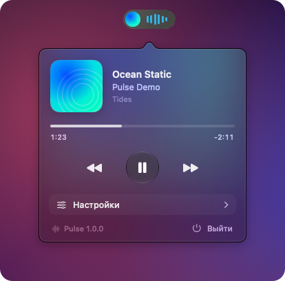
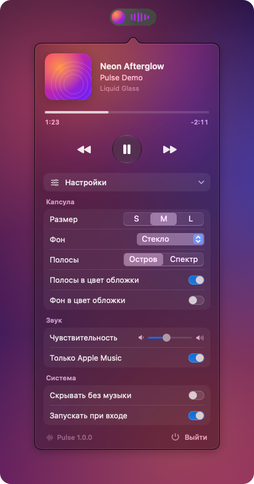
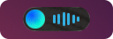
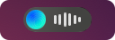
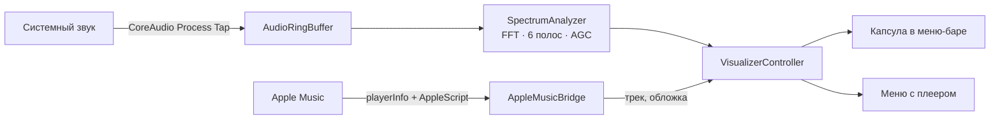

<div align="center">


# Pulse

**Музыкальный визуализатор для меню-бара macOS.**<br>
Стеклянная капсула с обложкой трека и живым 6-полосным эквалайзером, который слушает настоящий звук системы.


</div>

<table>
  <tr>
    <td align="center"></td>
    <td align="center"></td>
  </tr>
  <tr>
    <td align="center"><sub>Плеер прямо из меню-бара</sub></td>
    <td align="center"><sub>Настройки внешнего вида и поведения</sub></td>
  </tr>
</table>

## Возможности

- 🎚 **Живой спектр, а не анимация.** Pulse захватывает системный звук через CoreAudio Process Tap и раскладывает его быстрым преобразованием Фурье (`vDSP`) на 6 полос: от саб-баса до «воздуха».
- 🔊 **Работает при любой громкости.** Автоусиление подстраивается под уровень сигнала от 0 до −90 dBFS, поэтому полосы живые и на 100 %, и на 20 % громкости.
- 🫧 **Liquid Glass.** Капсула из системного стекла macOS 26+: обычное, прозрачное или классическое тёмное.
- 🎨 **Цвет обложки.** Полосы и фон капсулы можно подкрасить доминирующим цветом обложки. Каждый вариант включается отдельно.
- 🎵 **Apple Music.** Обложка, название, перемотка и ⏮ ⏯ ⏭ прямо из меню. Pulse никогда не запускает «Музыку» сам.
- 🎧 **Бережно к звуку.** Без микрофона: гарнитура не переходит в режим звонка. На паузе, в тишине и при выключенном экране Pulse почти не потребляет ресурсов.

## Внешний вид

<table>
  <tr>
    <th align="left">Размер</th>
    <td align="center"><br><sub>S</sub></td>
    <td align="center"><br><sub>M</sub></td>
    <td align="center"><br><sub>L</sub></td>
  </tr>
  <tr>
    <th align="left">Фон</th>
    <td align="center"><br><sub>Стекло</sub></td>
    <td align="center"><br><sub>Прозрачное</sub></td>
    <td align="center"><br><sub>Тёмное</sub></td>
  </tr>
  <tr>
    <th align="left">Полосы</th>
    <td align="center"><br><sub>В цвет обложки</sub></td>
    <td align="center"><br><sub>Обычные</sub></td>
    <td></td>
  </tr>
</table>

Стили полос: **«Остров»** (симметричный силуэт, как на скриншотах) и **«Спектр»** (слева бас, справа верха).

## Установка

Запускается на macOS 15 и новее; Liquid Glass появляется на macOS 26, на более ранних системах капсула полупрозрачная. Для сборки нужен Xcode 26 или новее (Swift 6, SDK macOS 26).

```bash
git clone https://github.com/infarmor/Pulse.git
cd Pulse
./scripts/build_app.sh
open dist/Pulse.app
```

Готовое приложение лежит в `dist/Pulse.app`, его можно перетащить в «Программы».

### Разрешения

При первом запуске macOS попросит два разрешения:

| Разрешение | Зачем |
| --- | --- |
| **Запись только системного аудио** | Живой спектр. Звук анализируется на лету, никуда не записывается и не отправляется. |
| **Автоматизация → Музыка** | Обложка, название трека и кнопки управления. |

Если что-то не выдано, меню подскажет и откроет нужный раздел Системных настроек.

## Управление

| Действие | Что происходит |
| --- | --- |
| Клик по капсуле | Открыть или закрыть меню |
| Правый клик (или ⌃-клик) | Быстрое меню: пауза, треки, выход |
| Повторный запуск Pulse | Вернуть скрытую капсулу и открыть меню |

## Как это устроено



| Файл | Роль |
| --- | --- |
| `Sources/PulseBar/CoreAudioTapEngine.swift` | Захват системного звука: приватный process tap и агрегатное устройство, перезапуск при смене устройства или частоты |
| `Sources/PulseBarCore/SpectrumAnalyzer.swift` | БПФ на 2048 точек, 6 музыкальных полос, автоусиление, сглаживание |
| `Sources/PulseBarCore/ArtworkPalette.swift` | Выбор яркого доминирующего цвета обложки |
| `Sources/PulseBar/AppleMusicBridge.swift` | Состояние «Музыки», обложка и управление без самозапуска |
| `Sources/PulseBar/VisualizerController.swift` | Связывает всё вместе, экономит энергию в тишине и при выключенном экране |
| `Sources/PulseBar/UI/` | Капсула и меню на SwiftUI |

## Разработка

```bash
swift test                     # тесты ядра (анализатор, буфер, палитра, настройки)
./scripts/build_app.sh         # сборка и подпись Pulse.app
```

Скриншоты в README генерируются автоматически в демо-режиме: сгенерированная обложка, вымышленный трек, без доступа к звуку и «Музыке». Ваши настройки при этом не меняются.

```bash
./scripts/screenshots/capture.sh          # все снимки → docs/screenshots
open dist/Pulse.app --args --demo         # просто посмотреть демо
```

## Лицензия

[MIT](LICENSE)
